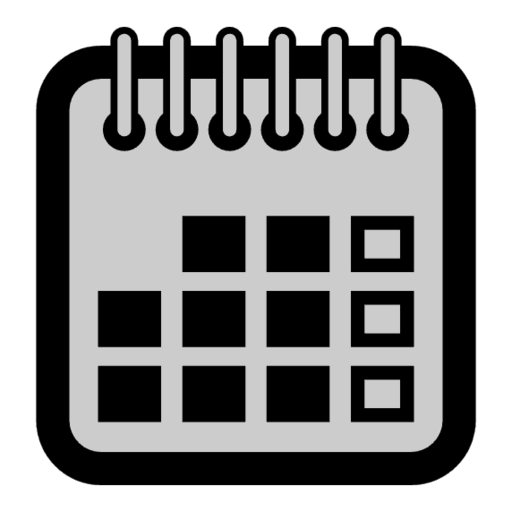
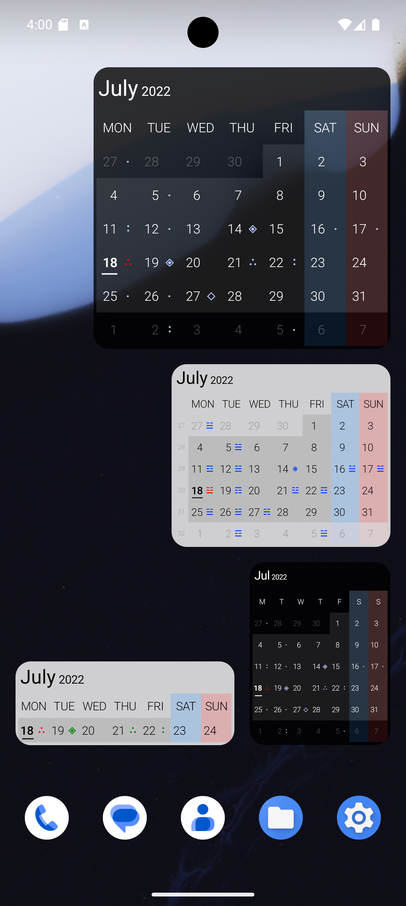
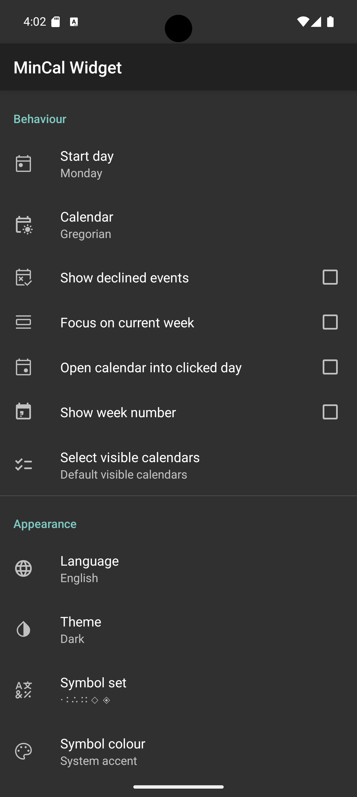
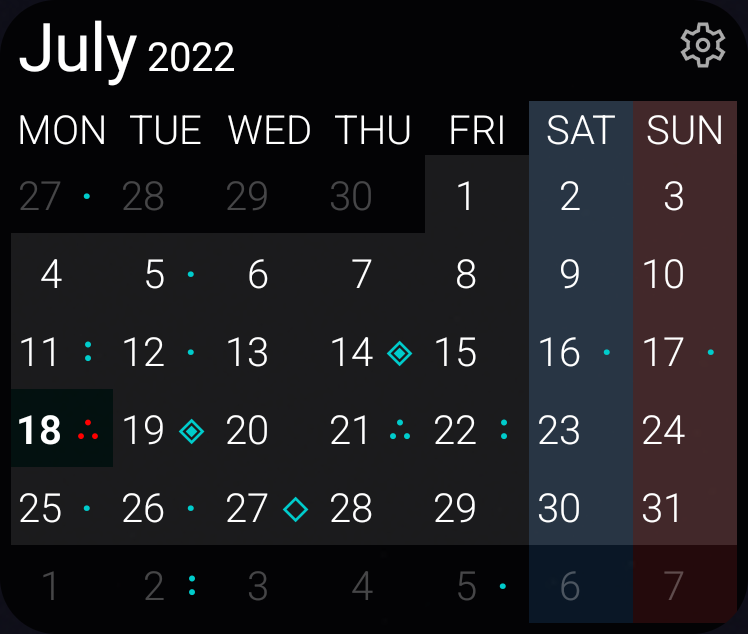

# MinCal Widget 

Minimal calendar widget that's always on current date

* Two formats: Month and Week (resizable with initial respective values of 3x2 and 3x1)
* Displays all visible events from your calendars with a symbol set (high number becomes generic)
* Native widget configuration access or press widget's top right corner
* Pressing on any other part of the widget opens calendar application
* Configurable per widget:
  - start day of the week
  - calendar (Gregorian or Holocene)
  - show declined events
  - focus on current week (Month only)
  - open calendar on clicked day
  - show week number
  - select visible calendars
  - theme
  - symbol set
  - symbol set colour
  - transparency
  - text size

## Installation

## Screenshots

## Supported languages

Everyone can help adding or updating translations under https://hosted.weblate.org/engage/min-cal-widget

## Licensing

MinCal Widget is licensed under the [BSD 3-clause](LICENSE.md).
